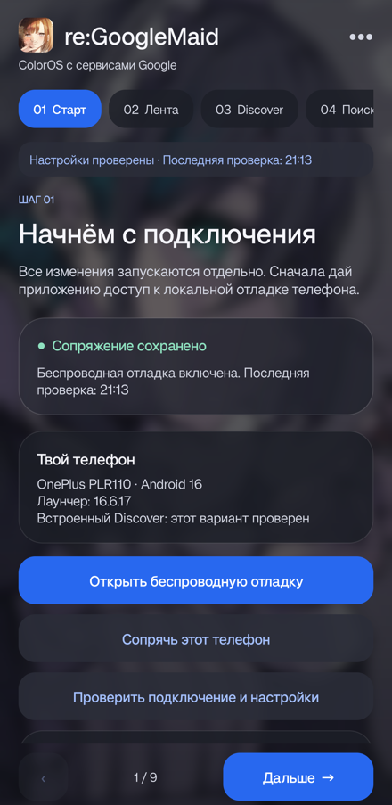

# re:GoogleMaid

[Русский](README.md) · [English](README.en.md)

A step-by-step setup wizard for Chinese ColorOS 16 devices using Google services. It provides nine setup steps, state checks, and separate confirmation before applying changes.

[Download APK](https://github.com/vaduur/reGoogleMaid/releases/latest) · [Detailed guide (Russian)](docs/GUIDE.ru.md) · [Test report and limitations (Russian)](VERIFICATION.md)



The app currently has a Russian-language interface. This page provides an English project description and setup overview.

## Compatibility

- Android 16 / API 36.
- Tested on **OnePlus Ace 6T PLR110** with the stock launcher **16.6.17**.
- Automatic Discover restoration is restricted to that model and launcher version. Other builds and work profiles have not been tested.
- Google services, Wi-Fi, and enabled wireless debugging are required.

## Setup steps

| Step | Function |
| --- | --- |
| Connection | Pair with this same phone through local ADB |
| Chinese feed | Instructions for disabling news and recommendations, with manual confirmation |
| Discover | Check the native panel, restore it, and monitor it in the background |
| Search | Prepare [ColorGoogle](https://github.com/joeyandu/ColorGoogle) and redirect the stock search button |
| Bottom gesture | Configure Circle to Search through ColorGoogle |
| Power button | Assign Google as the assistant and configure Google/Gemini |
| Apps | Browse 17 Google apps and choose default handlers |
| Permissions | Select each app's declared permissions separately |
| Background operation | Configure Doze exemptions and follow ColorOS autostart instructions |

Some actions use local debugging; others require a choice in Android or ColorGoogle. Opening a page does not grant permissions. Discover monitoring continues if the owner previously enabled it.

Discover restoration may disable AppPlatform for approximately 12 seconds and restart the home screen. Normal and fallback package restoration are included. This is an experimental workaround for the specified build, not a firmware modification.

The stock camera, system gallery, and necessary ColorOS services remain installed. The built-in Google search bar below the dock is not enabled without root. A complete first-time setup, reboot recovery, and long-term operation have not been verified across all configurations.

## Installation and ColorGoogle

Download the APK from [Releases](https://github.com/vaduur/reGoogleMaid/releases). If you already use the Ace6T Discover helper, install this as an update to preserve pairing. The package name remains `dev.local.ace6tdiscover`.

Search interception and system gestures use **[ColorGoogle](https://github.com/joeyandu/ColorGoogle)**, a separate open-source project. Its official 16.3.0 APK is bundled as a dependency. The wizard verifies its SHA-256 before installation and checks the installed version and signing certificate before starting its agent. Google apps are installed through Google Play.

## Building

Install JDK 17+, Android SDK 36, and Build Tools 36.1.0. Configure the SDK through Android Studio or a local `local.properties` file.

```sh
./gradlew assembleDebug
```

On Windows, run `gradlew.bat assembleDebug`. The APK is written to `app/build/outputs/apk/debug/`.

Developer builds use a locally generated Android debug key. They cannot update a release APK signed with a different key. The release signing key is not included in this repository.

## Data, source code, and licensing

Device management uses the phone's own local ADB connection. The pairing key is generated on the device, and pairing codes are not logged. The wizard does not separately enable cloud synchronization. The project includes adbclient source and the corresponding source archive for the bundled ColorGoogle version.

The code is licensed under **GPL-3.0-only**. See [LICENSE](LICENSE), [third-party notices](UPSTREAM-THIRD-PARTY-NOTICES.md), and the notices in `third_party/adbclient`. The icon and background were supplied separately by the project owner; the code license does not override rights to those illustrations.

This is an independent project, not an official Google or OPPO app.
