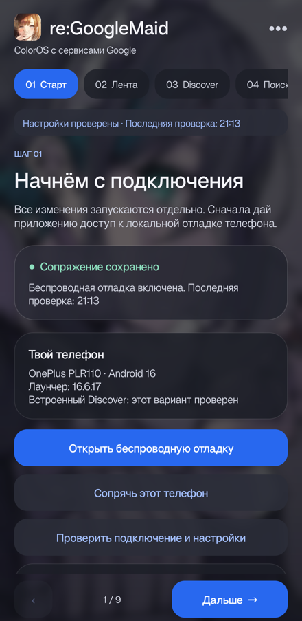

# re:GoogleMaid

[Русский](README.md) · [English](README.en.md)

Мастер настройки китайской ColorOS 16 с сервисами Google: девять шагов, проверки состояния и отдельное подтверждение изменений.

[Скачать APK](https://github.com/vaduur/reGoogleMaid/releases/latest) · [Подробная инструкция](docs/GUIDE.ru.md) · [Проверки и ограничения](VERIFICATION.md)



## Совместимость

- Android 16 / API 36.
- Проверено на **OnePlus Ace 6T PLR110**, штатный лаунчер **16.6.17**.
- Автопроцедура Discover ограничена этой моделью и версией лаунчера. Остальные сборки и рабочие профили не проверялись.
- Нужны базовые сервисы Google, Wi-Fi и включённая беспроводная отладка.

## Шаги

| Шаг | Что делает |
| --- | --- |
| Подключение | Локальное сопряжение ADB с этим же телефоном |
| Китайская лента | Инструкция по отключению новостей и рекомендаций; ручная отметка |
| Discover | Проверка встроенной панели, восстановление и фоновое наблюдение |
| Поиск | Подготовка [ColorGoogle](https://github.com/joeyandu/ColorGoogle) и перенаправление штатной кнопки поиска |
| Нижний жест | Настройка «Обвести и найти» через ColorGoogle |
| Кнопка питания | Назначение Google ассистентом, настройка Google/Gemini |
| Приложения | Каталог 17 Google-приложений и выбор стандартных обработчиков |
| Разрешения | Выбор заявленных доступов отдельно для каждого приложения |
| Работа в фоне | Исключения Doze и инструкция по автозапуску ColorOS |

Часть действий выполняется приложением через локальную отладку, часть требует выбора в Android или ColorGoogle. Открытие страницы не выдаёт разрешения. Существующее автовосстановление Discover продолжает работать, если владелец включил его ранее.

Восстановление Discover может примерно на 12 секунд отключить AppPlatform и перезапустить рабочий стол; предусмотрено возвратное и резервное включение пакета. Это экспериментальный обход для указанной сборки, а не изменение прошивки.

Камера, системная галерея и необходимые службы ColorOS сохраняются. Встроенная строка Google под доком без root не включается. Полный запуск с нуля, перезагрузка и долговременная работа на всех конфигурациях не проверены.

## Установка

Скачайте APK из [Releases](https://github.com/vaduur/reGoogleMaid/releases). Если уже установлена утилита Ace6T Discover, устанавливайте обновлением, чтобы сохранить сопряжение. Техническое имя пакета осталось `dev.local.ace6tdiscover`.

Движок поиска и системных жестов — **[ColorGoogle](https://github.com/joeyandu/ColorGoogle)**. Официальный APK версии 16.3.0 включён как зависимость. Перед установкой проверяется SHA-256, а перед запуском его агента — версия и сертификат. Google-приложения устанавливаются через Play Маркет.

## Сборка

Нужны JDK 17+, Android SDK 36 и Build Tools 36.1.0. Укажите SDK через Android Studio или локальный `local.properties`.

```sh
./gradlew assembleDebug
```

В Windows: `gradlew.bat assembleDebug`. APK появится в `app/build/outputs/apk/debug/`.

Самостоятельная сборка использует локальный Android debug-ключ. Она не обновит APK из релиза, подписанный другим ключом. Ключ опубликованных сборок в репозиторий не включён.

## Данные и исходники

Управление телефоном выполняется через его собственное локальное ADB-соединение. Ключ сопряжения создаётся на устройстве; коды не записываются в журнал. Мастер отдельно не включает облачную синхронизацию. Исходники adbclient и соответствующий исходный архив ColorGoogle включены в проект.

Код — **GPL-3.0-only**, см. [LICENSE](LICENSE), [third-party notices](UPSTREAM-THIRD-PARTY-NOTICES.md) и уведомления в `third_party/adbclient`. Иконка и фон предоставлены владельцем отдельно; лицензия кода не переопределяет права на иллюстрации.

Независимый проект; не является приложением Google или OPPO.
